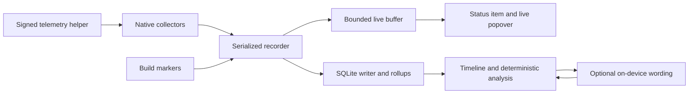
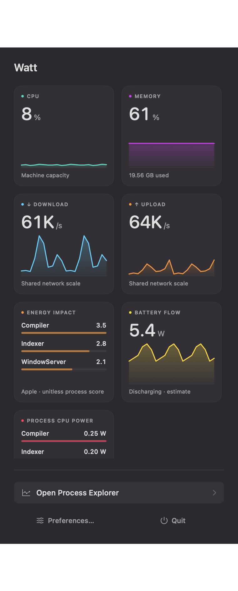

# Watt

A small instrument for the present. A useful record of the past.

**Design draft 0.9 · October 29, 2026 · Implementation in progress**

Watt is a native macOS menu bar app that replaces the CPU, memory, and network monitoring currently supplied by iStat Menus, adds configurable temperature and power monitoring, and records enough history to investigate slowdowns afterward. Beauty and a small menu bar footprint are product requirements, with the same priority as trustworthy measurements.

The recommended direction is one compact, fixed-width graphic, a carefully composed live popover, and one Process Explorer window combining live and historical investigation. This is an app for people who want to inspect how their Mac works: dense evidence, precise accounting, and useful controls should be readily available. Use SQLite for local history. Compute explanations from recorded evidence; optionally use Apple's on-de
 vice model to help ask questions and explain the results.

## 1. What is installed today

I inspected the iStat Menus preferences on this Mac without changing settings. The machine reports a MacBook Air with an Apple M5, 10 CPU cores, 32 GB of memory, and macOS 27.2. This is the first hardware target, rather than a promise of immediate support for every Mac.

| Area | Observed configuration | What Watt should preserve |
| --- | --- | --- |
| Global | Medium update frequency; Standard menu bar spacing; Indigo appearance | Configurable cadence and appearance, with a deliberately smaller footprint |
| CPU & GPU | Enabled; CPU graph and CPU label; five processes; process percentage format 0–100% | CPU user/system split, history, core groups, top processes, load averages, uptime, and available GPU details |
| Memory | Enabled; stacked used/free values; five processes shown by size | Used/free, pressure, app/wired/compressed memory, page-ins/outs, swap, top processes |
| Network | Enabled; stacked upload/download bandwidth; KB/s and MB/s; combined bandwidth; five processes; automatic sorting | Directional rates, history, interface state, addresses, totals, and process attribution where feasible |
| Sensors | Disabled; Detailed display; automatic temperature units | Add real supported temperatures, thermal state, and optional fan readings |
| Power | Disabled; internal battery selected in its configuration | Add battery/source/charging history and supported power measurements |
| Disks, Time, Weather, Combined | Disabled | Disk I/O is still needed for investigations; a calendar or weather replacement is outside this draft |

The preference panels contain demonstration readings. Their CPU percentages, temperatures, IP addresses, and fan speeds are not live measurements and were not used as evidence about this Mac's performance. No particular EDR product or security configuration has been identified in this inspection.

The exact occupied widths of the existing menu bar items have not been measured. The status-bar inspection timed out. The 48 pt concept below is a proposed drawing width, not a claim that the size requirement has already been met. The first prototype must compare total occupied width, including system padding, against the existing memory and network items on this display.

## 2. The experience

Three questions should take almost no effort:

1. **Now:** Is the Mac busy, under memory pressure, or transferring data?
2. **Then:** What was happening when I noticed a problem?
3. **Why:** Which recorded activity best explains it, and what remains uncertain?

The app should feel like a precision instrument: calm at idle, legible under load, and clear about missing information. High CPU can be useful work. A healthy build should not make the whole app turn red.

### Visual direction

[Editable vector concept](/Users/graham_gilbert/Dropbox/src/Mine/watt/docs/design/watt-concept.svg). All readings in the concept are illustrative. It establishes composition and hierarchy; final typography, native materials, and exact dimensions require a running macOS prototype.

Use native SwiftUI and AppKit materials, crisp custom vector graphs, restrained separators, and generous spacing. Support a pearl light appearance and charcoal dark appearance from the beginning. CPU uses mint, memory lilac, network blue, and thermal warnings amber in the expanded views. The menu bar defaults to a native monochrome treatment, with optional restrained color.

Avoid a grid of equally loud dashboard cards, oversized gauges, constant animation, and decorative gradients behind data. Large numbers belong to the most useful current measurement; supporting detail should read like well-set text. Use system typography, tabular digits, explicit units, and consistent baselines.

### One compact menu bar graphic

Working design name: **Ribbon**. One status item, with no permanent wordmark.

| Region | Default meaning | Encoding |
| --- | --- | --- |
| Upper left | CPU activity over approximately the last 30 seconds | Small waveform with a fixed 0–100% scale |
| Lower left | Memory pressure | A quiet segmented rail; increasing pressure fills more segments; used/free remains available on hover or click |
| Right | Upload and download activity | Two directional lanes with distinct arrow shapes and separately visible magnitudes |

Start at a 48 × 18 pt drawing area, test a 40 pt version, and retain the narrowest version that is genuinely readable. The release requirement is that the complete status item fit within the occupied width of either current reference item, with the narrower one the preferred target. If macOS padding makes this impossible at 48 pt, reduce the drawing width before accepting the design.

The CPU scale stays fixed. Network rates need a configurable scale, initially a fixed logarithmic scale that is explained in the popover; avoid automatic rescaling that makes a tiny transfer look like saturation. The memory rail must use a documented mapping from available pressure signals. Do not invent a precise pressure percentage from a qualitative OS state.

Keep channel positions stable. Do not rotate metrics, change width as numbers grow, or replace the waveform with an unexplained overall score. Stale data uses a broken trace; paused recording has a distinct static mark. An incident can leave a small acknowledgment mark without flashing or changing the width.

This preserves access to all the current information, while replacing permanent numeric bandwidth and used/free labels with glanceable graphics. Exact simultaneous values for every metric will not be legible in this space. Hover provides a compact numeric tooltip; clicking provides exact values immediately. If the graphic feels too abstract, include a user-selectable two-line numeric layout within the same width, prioritizing two chosen metrics.

CPU, GPU, memory, network, temperature, or power can be assigned to the primary graphic channels. Defaults remain CPU/memory/network. Temperature and power belong in the popover by default, rather than forcing seven tiny readings into the menu bar.

### Live popover

Clicking outside the popover dismisses it. The Process Explorer opened from it also hides when it loses focus, so an investigation does not leave a window covering the desktop. Recording continues after dismissal. Clicking the menu bar item reopens the live popover; Open Process Explorer restores the investigation window and its selection.

Target roughly 400 pt wide, fitting the available screen height. The first view should contain:

- A quiet header with device name and recording state, with one Open Process Explorer action.
- CPU with a short history and user/system split; memory with used/total and pressure.
- Upload/download with exact units and a shared directional chart.
- A restrained temperature and power line: for example, CPU sensor 78 °C · SoC estimate 18 W, only when supported.
- Five leading processes, with a CPU/memory/I/O selector and an explicit CPU percentage convention.
- The latest meaningful incident, such as “CPU busy · 2 minutes ago,” opening the relevant timeline interval.

Clicking a metric expands its detail in place or opens its focused history. GPU details live under CPU & GPU; network details expose interfaces, addresses, totals, and supported process rates. The CPU panel includes core groups, load, and uptime. The memory panel includes app/wired/compressed/free, swap, and paging.

Evaluate GPU utilization, memory, temperature, frequency, and FPS as individually gated parity candidates. The preference preview does not establish that every field is currently used. Shared GPU memory must be labeled accordingly. Some fields may not be obtainable on the M5 through a supported approach; confirm their importance and feasibility before calling Watt a complete iStat replacement.

### Unified Process Explorer

A resizable native window provides room for real investigation. Initial layout: a narrow navigation column, aligned metric tracks in the center, and an evidence inspector on the right. A smaller window collapses the inspector rather than shrinking graphs into illegibility.

The center has one time axis and one synchronized cursor across CPU, memory/pressure, disk, network, temperature, and power. Add tracks for builds, incidents, charging/source changes, sleep/wake, reboots, and recorder gaps. Select a point for a snapshot; drag a range for an explanation. Zoom from a minute to a day, month, or year as retained resolution permits.

The selected time appears prominently and stays frozen while inspecting history. A clear Live action returns to now. Each track exposes its scale, units, resolution, and missing intervals. Older minute averages must retain visible peak ranges so a short spike does not disappear into a smooth line.

The inspector shows a concise entry point into the full Process Explorer below. Actions include Compare with previous build, Bookmark, Explain interval, and Export selected evidence. Keep natural-language entry secondary to browsing, sorting, filtering, and inspecting evidence.

### Process Explorer: the full “What was busy?” view

The small contributor panel on the first concept board is only an overview. The primary investigation surface is a full, resizable process table linked to the timeline, with an optional tree and a selected-process detail pane. It should offer the information density of Activity Monitor and a profiler, with better historical navigation and typography. An explanation is an annotation alongside the data, not a replacement for it.

[Editable Process Explorer concept](/Users/graham_gilbert/Dropbox/src/Mine/watt/docs/design/watt-process-explorer.svg). All process names and values are illustrative.

Keep compact aligned CPU, pressure/swap, and disk tracks above the table. Moving the shared cursor changes every row to the same historical point. Selecting a time range switches columns to interval statistics, with the interval in the header. A table must never silently mix a live process value with an old system graph.

| Default columns | Meaning |
| --- | --- |
| Process / disclosure / PID | Executable or app name, expandable children in tree mode, stable process-instance selection |
| User | Account or UID; system processes remain inspectable when accessible |
| CPU average / peak | Selected-interval CPU rates; one-core or whole-machine convention is always visible |
| CPU time | User + system CPU seconds accumulated during the interval; expandable split |
| Memory | Physical footprint at the cursor, or last valid observation in a selected interval, explicitly labeled |
| Peak memory | Largest observed footprint in the interval |
| Memory change | Footprint delta between comparable observations; positive and negative changes visible |
| Disk read/s / write/s | Per-process disk throughput over the actual sampled interval; sortable independently |
| Disk bytes read / written | Valid counter deltas over a selected interval or range; units and coverage explicitly labeled |
| Threads | Observed count where available |

Columns are sortable, resizable, reorderable, and hideable. Offer presets for CPU, Memory, I/O, and All counters. Search by name, PID, user, bundle or signing identity; filter user/system processes, watched processes, processes observed in the interval, and those alive at the cursor. Show all recorded processes by default, rather than a top-five list. A top-contributors filter is available without changing what was recorded.

Additional columns and the detail pane can expose resident memory, private/shared or compressed memory where a validated source permits it, faults/page-ins, context switches, wakeups, process state, parent PID, start time, first/last observation, and supported per-process network counters. Unavailable counters display a reason rather than a zero. Virtual address space, if exposed, is clearly distinct from physical memory usage. Expensive counters can be collected only in detailed mode; the UI must indicate when they were not recorded.

#### Memory impact should be inspectable

Make footprint, growth rate, interval peak, and CPU/I/O cost the main evidence. Selecting a memory-heavy process reveals its footprint history alongside system pressure, compression, and swap growth over the same interval. Include exact byte values and human-readable units, plus comparison with the preceding interval or another marked build.

If per-process compression, dirty/private/shared pages, or paging counters are available, expose them with their measurement definitions. Otherwise show the supported footprint and system-wide context. A process can have a large footprint while the machine has no pressure. Coincident swap growth does not prove a particular process caused it. Do not assign an invented per-process pressure percentage or a mysterious “memory impact” score.

Memory change requires comparable observations. A newly observed process is marked new; an exited process shows its last observed footprint and is not treated as currently using that memory. Group growth must handle membership changes explicitly. Summed per-process memory can double count shared resources, so group summaries identify their aggregation method and must not masquerade as physical RAM totals.

#### Process tree, app groups, and lifetimes

Offer separate **Flat**, **Process tree**, **App**, and **Coalition** views where the grouping data is available. Parentage, bundle/app identity, and OS resource coalitions answer different questions; do not conflate them. Tree mode might show a recorded build tool, compiler workers, linker, and descendants, including exited children that existed during the selected interval.

Store links between process instances, not just matching parent PIDs later. Distinguish the observed current parent from an original launching parent when that history is unavailable. Unknown parents, reparenting, processes missed between polls, and gaps are visible. A dotted connector means an incomplete observed relationship, with text/VoiceOver equivalents. Do not invent missing compiler children.

Tree rows distinguish a process's **own** counters from **inclusive descendant** totals. Avoid counting descendants twice in totals. CPU time and compatible I/O deltas can be aggregated across known descendants; memory aggregation has a visible shared-memory caveat. Inclusive peaks must be computed from aligned observations, never by adding each child's independent peak.

For a selected range, support a historical union of observed descendants and a tree at the cursor. Label which mode is active. Processes that started, exited, or changed parent are marked. A short-lived process not captured by polling remains missing even in “all recorded” mode.

#### Selected-process detail

Per-process disk activity is a first-class view. Show separate read and write throughput histories synchronized with CPU and memory, current sampled rates, total bytes transferred over the selected range, and observed peaks at the recording cadence. Allow sorting/filtering by read rate, write rate, or total I/O to find compilers, linkers, indexing, backups, or security processes doing disk work. Preserve separate read and write values in storage, rather than only a combined activity score.

These counters describe the OS's attributed disk I/O, not every filesystem operation or every byte served by cache. Missing final counters, denied access, resets, and process churn can leave activity unaccounted for. An aggregate of observed processes is labeled as such and must not be presented as complete physical-device throughput. Do not infer accessed paths or security scans from throughput alone. Default collection does not retain file paths or a file-access trace.

Selecting a row opens CPU, footprint, and I/O mini-timelines; average/peak/CPU time; identity and signing metadata; lifetime observations; parent/children; available per-field counters; and recording coverage. Pin two or more process instances to compare their time-aligned curves. Keep raw samples available in a table and export the selection as CSV or a consistent evidence bundle.

The table header shows retained/observed process counts, denied reads, sample cadence, and gaps. In reduced recording modes it says “selected contributors recorded” prominently, rather than implying that an empty search proves the process was absent. Historical views do not offer a misleading kill action for an old PID.

### Accessibility and polish

Provide full keyboard access, a configurable global shortcut, VoiceOver summaries, large text support, Reduce Motion, Increase Contrast, and color-independent states. The tiny graphic has a useful accessibility label with current numeric values. Graphs provide a textual/table equivalent. Verify light/dark menu bars, active/inactive displays, Retina rendering, notch constraints, full screen, and display changes. Do not rely on color alone to distinguish upload and download.

## 3. Answering “why was my CPU maxed out?”

The explanation begins with deterministic calculations over the selected interval. It should separate direct measurement, a plausible explanation, and missing evidence.

An illustrative result could read:

> CPU averaged 94% during this build. Compiler processes accounted for 62 percentage points of total machine capacity; the observed security-agent group accounted for 18. Both were elevated during the build. Memory pressure remained normal. Security activity may have contributed to contention, but this recording does not establish that the agent scanned these artifacts or delayed the build.

Every number links to its underlying chart interval or process observations. Show any unaccounted share separately; it can include kernel work, missed processes, access restrictions, and sampling mismatch. Do not calculate a misleading residual by mixing process and system CPU conventions or mismatched time windows. Display elapsed CPU time as well as peak and average rates.

Use “observed,” “consistent with,” and “not established” where appropriate. A process name alone does not establish that a process belongs to a security product. Cache signing identity when available and let the user confirm process groups or watchlists. Baselines should compare similar recording modes and known build windows, rather than arbitrary idle time.

### Build markers and incidents

Offer a manual Record this build action and an optional small CLI wrapper, conceptually `watt record --label "Debug build" -- <build command>`. This records start/end, exit status, and a user-supplied label; it runs the command only when the user invokes it. Do not store full arguments or environment variables by default. A marker improves correlation without requiring invasive tracing.

Initial incident rules, all configurable, include sustained CPU above 90% for 15 seconds, sustained memory pressure, rapid swap growth, serious thermal state, and unexpectedly high watched-process activity. Add cooldown and hysteresis. Manual recording is available even when no rule fires.

Maintain two minutes of rolling context and preserve up to five minutes after a trigger, extending only to a bounded maximum. A trigger can increase future process sampling from five seconds to one second. It cannot recover short-lived processes or finer samples from before the trigger. Record mode changes on the timeline.

For a stronger EDR conclusion, offer an explicit reproduction workflow using authorized vendor diagnostics or an appropriate trace. Merely seeing a security process and a compiler spike together is insufficient. Even adding Endpoint Security events would not by itself reveal another security product's scan decisions or time spent blocking a file operation.

## 4. Collection and platform feasibility

Recommended baseline: native Swift, initially Apple Silicon on macOS 26 or later, validated first on this M5 Air. Keep optional AI independent of the minimum useful monitoring feature set. Broader hardware support is a later compatibility commitment.

| Capability | Planned source | Feasibility and limits |
| --- | --- | --- |
| System/per-core CPU and load | Mach host/processor counters and native load APIs | Delta-based; discover core topology instead of assuming a fixed performance/efficiency split |
| Memory, compression, swap, paging | VM statistics and swap counters | Define each category; validate against OS tools; pressure signals are distinct from memory-used percentage |
| Process CPU, footprint, disk I/O | libproc and `proc_pid_rusage` | Access can vary by process/field; polling can miss short-lived processes |
| Process identity and parentage | Native process metadata/start identity | Boot + PID + start identity; sampled parentage is incomplete |
| Aggregate network | Interface counters and interface state | Avoid double counting VPN/tunnel traffic; persist interface lifecycle |
| Per-process network | Dedicated adapter, evaluated against native networking tools | Required parity investigation; do not assume process I/O counters include networking or promise root-free access |
| Disk activity and capacity | Native volume/device counters | Collect activity for explanations; capacity is a slower configurable collector |
| Battery, charging, source | IOKit power-source APIs | Public baseline; battery discharge is distinct from component power |
| Thermal pressure | `ProcessInfo.thermalState` | Public severity signal; does not provide Celsius or directly prove CPU throttling |
| Temperatures, component watts, fans, GPU details | Isolated hardware-specific SMC/HID/IOReport adapters; optional privileged source | Discover and validate each field on this machine; no universal stable public sensor API is assumed |

Apple's [XNU resource definitions](https://github.com/apple-oss-distributions/xnu/blob/main/bsd/sys/resource.h) and [process definitions](https://github.com/apple-oss-distributions/xnu/blob/main/bsd/sys/proc_info.h) provide the relevant process counters and identity fields. Apple documents [thermal state](https://developer.apple.com/documentation/foundation/processinfo/thermalstate-swift.property) separately from temperature. The [Stats sensor implementation](https://github.com/exelban/stats/blob/master/Modules/Sensors/readers.swift) demonstrates hardware-specific approaches; its [documentation](https://github.com/exelban/stats#sensors-show-incorrect-cpugpu-core-count) also warns that sensor keys change and sensor labels do not necessarily correspond to individual CPU cores.

### Sensors and power are a first-class workstream

Inventory actual sensor IDs, names, units, measurement scope, refresh cadence, and access requirements on the M5. Let users choose favorites and hide noisy or duplicate readings. A CPU thermal zone must not be presented as a precisely mapped individual core without evidence. Never average unrelated temperatures into an undocumented “Mac temperature.”

Power readings must distinguish battery discharge, adapter rating, measured input if available, and estimated CPU/GPU/SoC power. Do not add overlapping component measurements. Do not label an energy-impact score as watts or assign exact watts to a process without a valid measurement source.

The installed `powermetrics` command rejected an unprivileged one-sample CPU-power request with “must be invoked as the superuser.” Its manual describes estimated power and measurement limitations. Treat it as an optional source to prototype, with bounded sampling and clearly labeled estimates. Do not launch a privileged subprocess on every UI refresh.

Fan monitoring is shown only if hardware discovery finds fans; the Air must not display the demonstration fan readings from iStat. Fan control is outside this product's initial scope.

### Access tiers

The user has explicitly accepted a privileged helper where needed. Include a signed helper in the architecture and use it for specific sensor/power or cross-user process capabilities that the feasibility spike establishes. Broad and useful process coverage takes priority over avoiding a helper. The app can still show available baseline readings if the helper is unavailable.

Its XPC API accepts typed, allowlisted telemetry requests, validates the calling app, and exposes no general shell execution or arbitrary file reading. Use Apple's [SMAppService](https://developer.apple.com/documentation/servicemanagement/smappservice) for applicable service registration and approval. Plan installation, version negotiation, authenticated connections, reconnection after crashes, updates, removal, and clear diagnostics for a disabled or mismatched helper. Root access does not bypass SIP, privacy controls, entitlements, or hardware/API limitations; preserve field-specific capability reporting.

A separate future deep-tracing tier may use Endpoint Security. Apple requires a [specific entitlement](https://developer.apple.com/documentation/bundleresources/entitlements/com.apple.developer.endpoint-security.client); do not make ordinary history depend on receiving it. Track event drops if it is introduced.

Proposed distribution is a signed, notarized direct-download app. Decide sandboxing and helper packaging after testing required capabilities; do not promise Mac App Store distribution before resolving sensor/API restrictions. Baseline monitoring should not demand Accessibility, Screen Recording, or Full Disk Access as a blanket permission. Request any justified optional access at the feature that requires it. Wi-Fi names, public IP discovery, active latency probes, and vendor logs each need separate capability/privacy decisions.

## 5. A historical record with honest limits

“What was the state at this time?” means the measurements covering or nearest that time, with their actual resolution and coverage. It cannot mean an exact replay of all machine state. The UI must say, for example, “1-second system samples · 5-second process inventory · some processes unavailable.”

Start with these configurable defaults; tune them using measured overhead and database growth:

| Data | Cadence | Proposed retention |
| --- | --- | --- |
| System CPU/memory and aggregate disk/network | 1 second | 48 hours detailed |
| Observable-process baseline counters | 5 seconds; 1 second in bounded incidents/build recordings | 48 hours detailed |
| Temperature and supported power sensors | 5 seconds | 48 hours detailed |
| Capacity and slowly changing metadata | 60 seconds or on change | As needed for retained history |
| System and retained-contributor summaries | 1 minute | 30 days |
| Long-term system summaries | 15 minutes | 1 year |
| Saved incident details | Original available resolution | 14 days; optional pins within a separate quota |

The proposed default, **Full inventory**, records baseline CPU, physical footprint, and supported disk counters for every observable process at five-second intervals. Record lightweight identity/lifetime metadata with these samples. This supports a useful historical process table and lets the user discover an unexpected contributor afterward. It still cannot observe every process born and exited between polls. Expensive extended fields are individually gated and benchmarked.

Provide **Contributors only** as a reduced-storage option, persisting the union of top CPU, memory, and disk contributors plus watchlists, initially capped at 40 instances per frame. Prioritize watched and CPU contributors if the cap is reached and expose truncation. Finding the leaders can still require reading many processes, so this mainly saves storage until collection-cost measurements establish otherwise. Do not silently switch the default to this mode when storage fills; prune old history or show that detail recording paused.

Show retained contributors' share of CPU only when matched system/process intervals make that calculation meaningful. Also show observable/denied process counts and dropped samples. Full inventory is a proposed default subject to the overhead and storage gate in Phase A; if five-second recording cannot meet those budgets, resolve cadence/breadth explicitly before shipping.

Twenty process rows every five seconds produce 345,600 rows per day; 600 produce 10,368,000. These are row counts, not predicted database sizes. Benchmark actual storage including indexes, metadata, sensors, and WAL before promising a retention duration.

Begin prototype evaluation with an 8 GB recording budget plus a separately visible 1 GB pin budget, counting database, indexes, WAL, and exports retained by Watt. This higher budget reflects full process inventory, rather than only a short list of contributors. Retention ages are targets subject to these caps. Show actual oldest detailed data and an estimated remaining horizon. Prune oldest unpinned detail before summaries. Reserve disk headroom, reuse pages, and pause detail recording visibly if a cap cannot be maintained. Pinned incidents must not silently bypass limits.

The default recording mode continues while the popover/window is closed and while the screen is locked. Offer a battery-saver mode with slower sampling, and show its resolution changes in history. Never wake the machine just to sample; sleep is a gap, followed by a fresh baseline. Quitting Watt stops recording; launch at login is configurable.

## 6. Storage and data model

Use **SQLite**, with one serialized writer and bounded readers. This matches a local single-device app and keeps installation, backups, migrations, and inspection straightforward. SQLite's own [guidance](https://www.sqlite.org/whentouse.html) supports embedded and desktop application storage. A separate time-series server would add background work and deployment complexity. DuckDB or Parquet may become useful export/analysis formats if long-term analytical requirements grow; neither is needed for the initial continuous recorder.

Store the live database under the user's local Application Support directory, outside this Dropbox checkout and outside cloud-synchronized folders. Use a stable application identifier before implementation. Exports are separate consistent snapshots.

| Entity | Essential contract |
| --- | --- |
| Device / boot / recording session | Hardware/OS context, boot identity, collector versions, configuration changes; no hardware serial needed |
| Process instance | Boot + PID + start identity; executable/signing metadata when available; observed parent instance and uncertainty |
| Sample frame | UTC wall time, continuous/monotonic time, actual interval, recording mode, per-collector coverage |
| System sample | Typed CPU, memory, swap, paging, aggregate I/O values and validity |
| Process sample | Frame + process instance, cumulative user/system CPU and I/O counters, footprint, available extended counters, per-field validity |
| Process relationship | Child instance, parent/app/coalition instance, relationship type, observed interval, provenance, completeness |
| Interface / volume / sensor sample | Stable source identity, units, measurement scope, source adapter, value, timestamp, status |
| Collector gap | Start/end, affected collectors, sleep/paused/denied/error/drop/expired reason |
| Incident / build / bookmark | Interval, trigger or marker, evidence references, user notes, pin state |
| Rollup | Resolution, covered duration, min/max/time-weighted mean/last gauge, valid counter deltas, retained contributors |
| Explanation | Evidence IDs, structured claims, rule/model version, generation time, limitations |

Use typed metric-family tables rather than one string-heavy row per metric. Index time-range queries and process identity; schema migrations are versioned and tested with recorded fixtures.

Keep these invariants explicit:

- PID reuse never joins two process lifetimes. “First/last observed” does not prove creation/exit; an unknown start identity cannot be treated as a known match.
- Cache expensive identity/signing metadata instead of rereading it at every tick; preserve executable changes and time-varying parent/group membership within a process lifetime.
- Store original cumulative counters where practical. Derive rates from actual elapsed intervals, and invalidate resets, reboot crossings, or replaced interfaces.
- Never charge an entire lifetime CPU/I/O counter to the first observed sample interval. A missing final sample can leave exit-time activity unaccounted for. CPU averages use valid covered elapsed time, and CPU/memory peaks are explicitly sampled peaks at the stated cadence; an OS lifetime maximum is a separate field.
- Wall-clock changes cannot create negative rates. Store UTC plus elapsed time and display the local time zone and offset, including ambiguous daylight-saving times.
- Missing, disabled, stale, denied, unsupported, and zero are different states. Do not interpolate across gaps.
- System CPU is 0–100% of machine capacity. Process views can use either one-core percentages or machine-normalized shares, with labels and a setting. Never silently mix them.
- Do not sum process resident memory or footprint and call it total physical RAM consumption; shared memory and accounting semantics differ.
- Detail that expired cannot be reconstructed from summaries. Older process rollups cannot answer an exhaustive “every process” question.

Use WAL for concurrent recording and reading, with short read transactions and materialized chart results. Monitor checkpoint progress and bound WAL growth; long-lived readers can prevent checkpoint completion. Batch routine writes approximately every five seconds, flush important markers promptly, and document that an abrupt crash may lose queued samples. Choose and benchmark the durability setting explicitly. These tradeoffs are described in [SQLite's WAL documentation](https://www.sqlite.org/wal.html).

Use bounded queues and backpressure so disk-full or a slow query cannot freeze the menu bar. Persist a gap after recovery. Prune in small batches, with incremental reclamation where appropriate; deleting rows alone does not normally shrink the file. Schedule expensive compaction during quiet periods with adequate free space. See [SQLite VACUUM](https://www.sqlite.org/lang_vacuum.html). Export through the [online backup API](https://www.sqlite.org/backup.html) or another consistent snapshot mechanism, rather than copying only the active database file.

## 7. Optional on-device explanations

Use Apple's explicit [SystemLanguageModel](https://developer.apple.com/documentation/foundationmodels/systemlanguagemodel) and check runtime availability. The framework name alone must not imply that every model/provider is on device. No automatic cloud fallback.

The model can turn “Why was my Mac slow around 10:15?” into a bounded interval query, summarize a computed evidence bundle, and suggest useful comparisons. Deterministic code computes all rankings, durations, numerical differences, and coverage first.

Use [guided generation](https://developer.apple.com/documentation/foundationmodels/generating-content-and-performing-tasks-with-foundation-models) and allowlisted [read-only tools](https://developer.apple.com/documentation/foundationmodels/expanding-generation-with-tool-calling), such as select interval, retrieve contributors, and compare marked builds. Each generated claim must cite evidence IDs; validate numbers and links before display. Process names, labels, and imported log text are untrusted data, never instructions.

If the model is unavailable, slow, refuses, or produces an unsupported claim, show the deterministic explanation. Do not give it arbitrary SQL, shell execution, or authority to change security settings. No inference runs on the sampling path or automatically during CPU saturation. Record Watt's own CPU/I/O and model-inference intervals so its work is visible in the history.

## 8. Configuration and privacy

Separate **show**, **record**, and **alert** settings. Hiding a sensor should not unexpectedly stop its history. Disabling recording should explain that historical questions about that metric will no longer be answerable.

| Settings group | Controls |
| --- | --- |
| Menu bar | Width/layout preset, fixed channel assignments, monochrome/color, network scale, numeric alternative |
| Metrics | CPU/GPU, memory, disk, network, battery, temperature, fans, power; favorites, units, per-source support status |
| Recording | Full inventory/contributors only/battery saver/detailed build, cadence, extended fields, retention, budgets, launch at login, pause/resume |
| Process Explorer | Column presets, CPU convention, flat/tree/app/coalition view, own/inclusive totals, byte format, filters, comparisons |
| Investigations | Incident thresholds, cooldown, pre/post windows, build markers, process groups/watchlists |
| Alerts | Per-category opt-in notifications and quiet periods; visual incident indication independently configurable |
| Intelligence | On-device explanations enabled/disabled, model status, explanation history |
| Data | Storage used, actual history horizon, export preview, exclusions, delete range/all history |

Default data stays local. Record process identity and performance counters, but not full command lines, environment variables, file-access logs, visited domains, or packet contents. Let users exclude sensitive processes or pause recording. Recording public IP, SSID, or sensitive diagnostic logs is separately configurable and off by default; live address display can be enabled independently.

SQLite is not encrypted by default. Use restrictive file permissions and the Mac's disk encryption; document this plainly. Application-level database encryption can be evaluated if the threat model requires it. A deletion feature must address WAL, derived explanations, cached exports, and backups honestly, without claiming secure erasure of SSD blocks or copies outside Watt's control.

Evidence export previews the selected range, fields, omissions, and redactions before writing a local file. Sharing is a separate user action. Exported reports include resolution/coverage and distinguish observed data from interpretation.

## 9. Implementation shape

AppKit owns the status item, precise drawing, popover/window behavior, and lifecycle. SwiftUI provides content and settings; Swift Charts or a small custom chart layer supplies linked timelines after a rendering/performance comparison. Native collectors run off the main thread. No recurring `top`, `ps`, `ioreg`, or `nettop` process per refresh in the production recorder.

Begin with one user-session app and a background recorder component inside it, using the signed telemetry helper for privileged reads. Closing windows leaves recording running. Add a separate recorder service only if crash isolation or lifecycle requirements justify it. Hardware adapters, analysis, persistence, and presentation remain independently testable. Hardware/API-specific failures must not take down CPU/memory recording.

## 10. Phased delivery and decision gates

### Phase A: Prove the small graphic and the hard measurements

Build a disposable native status-item prototype with realistic recorded/fixture data. Compare Ribbon and the numeric alternative at actual menu bar size, in both appearances. Measure total occupied width against the current iStat memory/network items. Decide whether to emphasize memory pressure or used/free in the default glyph.

In parallel, run a collection spike on this M5: CPU/memory/process coverage, root/security-process access, parent/coalition relationships, extended memory counters, per-process network, GPU fields, and real temperature/power sensors. Compare readings with iStat and native tools over matched intervals. Document supported/unsupported fields and the helper's concrete contribution. The helper is an accepted implementation option, so prototype privileged reads when needed rather than dropping a valuable field solely to avoid elevation. Confirm which preview-only details, such as public IP, Wi-Fi name, or GPU FPS, matter for actual parity, then resolve their feasibility explicitly.

**Exit:** an approved actual-size visual direction, a concrete parity checklist, a capability matrix from this Mac, and measured overhead/storage estimates. Any unavailable iStat field is an explicit product decision before implementation expands.

### Phase B: A beautiful daily monitor

Implement the fixed-width status item, live popover, metric details, configuration, accessibility, and degraded states. Include temperature and power wherever Phase A established reliable sources. Verify supported values and units. Keep iStat available during comparison; switching daily use is a user choice.

**Exit:** current enabled information is accessible, new thermal/power sources are configurable, the width requirement passes, and the live UI is useful with optional permissions denied.

### Phase C: Useful history

Implement SQLite, retention, aligned tracks, the full Process Explorer with flat/tree/app views, point/range inspection, memory and CPU accounting, process comparisons, incident capture, build markers, bookmarks, and deterministic explanations. Surface incomplete coverage and expired detail. Export reproducible evidence bundles and raw selected samples.

**Exit:** record a real build, revisit the event the next day, and explain its observed CPU/memory/I/O/thermal context without relying on a screenshot or a model.

### Phase D: Better questions and deeper evidence

Add bounded on-device natural-language queries, baseline comparisons, optional vendor-log adapters, and only then consider an entitled lifecycle/tracing integration. Broaden hardware support using recorded compatibility fixtures and sensor inventories.

**Exit:** explanations remain evidence-linked and correct when the model is unavailable or missing data prevents attribution.

## 11. Acceptance criteria

All performance figures below are proposed budgets, not measured results:

| Area | Acceptance check |
| --- | --- |
| Menu bar | Exactly one fixed-width item; complete occupied width fits an existing memory/network reference item; no width changes under load |
| Beauty | Review running light/dark designs at 1× logical size, dense menus, and large text; no clipped numbers, muddy graph strokes, or visually identical upload/download states |
| Live parity | Checklist covers every currently enabled CPU/GPU, memory, and network field; any unavailable field is explicitly accepted before replacement |
| Temperatures/power | Every displayed source has verified units/scope on this M5; unavailable readings show a reason; estimates are labeled; no fake fan |
| Recorder overhead | Target under 1% of one CPU core averaged over an idle hour in Full inventory mode at five seconds, and under 150 MB steady memory, including any helper; report sensors separately |
| Energy and builds | Repeated matched build runs target under 2% median duration overhead; measure variance and idle/battery behavior rather than claiming a fixed energy saving |
| Interaction | Cached popover target under 100 ms to appear; typical 24-hour history query target under 300 ms on this Mac with a full budget-sized database |
| Process correctness | PID reuse stays separate; rapid compiler churn and access-denied processes yield honest coverage rather than invented zero activity |
| Process Explorer | Point/range semantics stay consistent; CPU average/peak/time and footprint/peak/delta are sortable; exited/new processes are labeled; own/inclusive counters avoid double counting; parent and app groupings stay distinct |
| Memory impact | Footprint, growth, available detailed accounting, and time-aligned pressure/swap can be inspected; unsupported metrics and shared-memory aggregation limits are visible |
| Time correctness | Sleep/wake, reboot, missed timers, counter resets, wall-clock changes, and daylight-saving ambiguity preserve correct intervals and visible gaps |
| Storage correctness | Disk full, writer failure, crash recovery, migration failure, WAL growth, pruning, pin quotas, and consistent export are exercised with representative data |
| Explanation | A compiler/security-agent overlap produces correlation language; no unrecorded scan, file path, blocking time, or process watts are invented |
| Privacy/accessibility | Exclusions and pause affect history as described; exports reflect redactions; all primary tasks work with keyboard and VoiceOver |

If a collector breaks the overhead budget, optimize or slow that collector and show the resolution change. Do not sacrifice reliable collection elsewhere or conceal Watt's own cost. Measure against the current iStat configuration as a baseline before claiming Watt is more efficient.

## 12. Decisions for the next design iteration

| Decision | Starting recommendation | Evidence needed |
| --- | --- | --- |
| Graphic vs exact numbers | Ribbon by default; numeric alternative | Actual-size comparison during real work |
| Width | Aim 48 pt drawing, test 40 pt; occupied-width requirement governs | Measurement of the current reference items |
| Memory channel | Pressure in glyph; used/free immediately in popover | Whether this preserves the glance information you value most |
| Default thermal/power detail | Favorite CPU thermal zone, thermal state, SoC estimate and battery/source | Verified M5 capabilities and helper cost |
| Recording detail | Full five-second process inventory; explicit detailed build mode; contributors-only storage option | Overnight growth, full-inventory overhead, and a compiler-churn recording |
| Helper | Accepted; signed narrow service for readings that need it | Field-by-field access/cost results, install/update/removal prototype |
| History | SQLite; 48-hour detail, 30-day minute summaries, one-year system trend subject to budget | Measured bytes per day and query latency |
| Distribution | Direct download, signed and notarized | API and packaging feasibility |
| Intelligence | Optional on-device wording after deterministic analysis | Accuracy, latency, availability, and resource impact |

## Revision log

| Version | Date | Change |
| --- | --- | --- |
| 0.1 | 2026-10-29 | Initial plan based on local iStat configuration inspection, a vector design concept, and platform/storage feasibility research |
| 0.2 | 2026-10-29 | Expanded What was busy into an expert Process Explorer with CPU/memory/I/O accounting, historical process trees, full-inventory recording as the proposed default, and an accepted privileged-helper architecture |
| 0.3 | 2026-10-29 | Made per-process disk read/write rates, totals, sorting, and aligned histories explicit; added click-away dismissal for the popover and Process Explorer |

| 0.4 | 2026-10-29 | Added implemented menu-bar appearance controls for layout, width, metric rows, network lanes and color; clarified battery source/invalid zero-current handling; outside-click verification remains open |

| 0.5 | 2026-10-29 | Implemented SQLite date/range drilldown with process interval summaries, a synchronized cursor and selected-process traces; added configurable numeric upload/download overlays without expanding the status item |

| 0.6 | 2026-10-29 | Unified live processes, historical cursor and interval summaries in one Process Explorer; replaced the popup gear menu with direct appearance/pause/quit and interval buttons; appearance is available only from the popup |

### Navigation decision, version 0.6

Live and historical process investigation share one window, timeline and selection. There is no separate History destination. Date/time, window width and Earlier/Later controls load older data into the same view; Live returns to current activity. At cursor shows the recorded process list and optional observed parent tree; Interval summary shows CPU/memory/disk aggregates for the loaded range. Selecting a process keeps its traces within that same surface.

The menu bar popup has one Open Process Explorer button. Appearance, Pause/Resume, Quit, and 2/5/10-second cadence choices are direct buttons in the popup, without a gear menu or submenu. Appearance has no additional entry point in the investigation window.

| 0.7 | 2026-10-29 | Added enabled-by-default CPU/memory percentage overlays, configurable alongside network values, with live appearance preview and a minimum readable width for all numeric channels |

| 0.8 | 2026-10-29 | Made bold bar graphs the menu bar default with contrasting numeric cutouts; replaced default gray popup button chrome with one primary Explorer row, a quiet utility toolbar and grouped cadence buttons |
| 0.9 | 2026-10-29 | Simplified the menu bar after actual-size review: steady-color system digits, separate meter strokes, rounded K rates, and optional history bars/lines. Removed striped backgrounds and inverted text. |

The compact numeric rows identify CPU with C and memory with M, including when the rows are reassigned. Optional color uses mint for CPU and purple for memory; text stays in the native foreground color. Two-line numeric mode spells out CPU and MEM.

CPU and memory numeric rows are left-aligned to a fixed origin so one-, two-, and three-digit values do not shift the metric labels. Network rates remain right-aligned.

### Popup dashboard refinement · November 5, 2026

Use paired CPU and memory percentage area charts, separate download and upload traces with a shared scale, and a battery-flow magnitude trace. Keep current values above the graphs and concise supporting values below. Preserve recording gaps in every trace. Three busiest processes use horizontal activity bars, with full detail in Process Explorer. Battery flow remains explicitly an estimate and is not total AC consumption.

Memory accounting correction: used RAM excludes file-backed cache and purgeable anonymous pages, using anonymous minus purgeable + wired + physical compressor pages. New samples carry memoryAccounting=app-wired-compressed; older snapshots retain their original cached-memory-inclusive VM estimate and are not rewritten.

Sparkle distribution: signed stable/prerelease feeds, hourly automatic checks, manual checks and prerelease opt-in in a unified Preferences pane. Release jobs verify the embedded public key, sign nested Sparkle helpers before the app, notarize the payload, sign notes and feeds, and publish universal DMGs. Stable promotion preserves the original payload signature.

Preferences now combines sample interval, menu bar appearance, and Sparkle update options in one native window. The popup footer only offers Preferences and Quit. Utility buttons have a single rectangular hit target covering icon, text, and padding. Sample interval persists across launches.

Appearance persistence uses the fixed com.grahamgilbert.Watt preferences domain. A one-time migration copies missing menu settings from the dev.watt.local prototype domain and preserves explicit choices in the new domain, including an explicitly disabled color setting.

### Configurable square tile layout and process energy

The popup uses a configurable two-to-six-column grid of square metric tiles. CPU, used memory, download, upload, battery flow, process CPU power, and Energy Impact are initially visible on a new installation; existing layouts retain their saved visibility. Preferences opens a separate layout editor: drag disabled tiles from the left palette into a position on the right preview, reorder there, or drag them back to disable. Optional full-width tiles, reset, and keyboard-friendly movement remain available. Hidden tiles consume no grid space. More content scrolls inside the popup while its action footer stays reachable.

Per-process energy uses the kernel CPU-energy nanojoule counter, preserving unavailable readings, PID lifetimes, counter resets and recording gaps. Show estimated watts at a snapshot, historical joules, weighted average/peak watts and coverage in Explorer, plus process energy in the popup. This is not Apple's unitless Energy Impact score and does not include GPU/system energy. See Apple's [Recount CPU-energy definition](https://github.com/apple-oss-distributions/xnu/blob/main/osfmk/kern/recount.h) and [rusage_info_v6](https://github.com/apple-oss-distributions/xnu/blob/main/bsd/sys/resource.h).

### Apple process Energy Impact integration (0.1.1 prerelease)

The signed optional helper runs a fixed one-second `powermetrics --samplers tasks --show-process-energy` capture at the selected cadence. Install/remove controls and status live in Preferences. Service registration uses SMAppService and administrator approval; no collection starts merely by opening Preferences. Both XPC peers enforce exact Developer ID identities and the same team. The helper accepts no command arguments or output paths, bounds capture time/output, and exits when idle.

SQLite frames retain the unitless per-second score with capture ID and timestamps. Popup rankings and Explorer match process PID/start lifetime and reject stale or future readings; historical averages/peaks count unique captures and actual capture coverage, excluding gaps. CPU watts/joules remain separate. Scores do not promise Activity Monitor application-total parity. Live privileged validation, sensor/component power, and exact app coalition attribution remain outstanding.

### Protected processes and security-agent coverage

Record running system extensions and security daemons even when macOS denies resource access. Preserve a public PID/parent/UID/start identity and show restricted counters as unavailable. Public fallback names can be truncated; do not infer a full signing or extension identity from a name prefix. The selected-process inspector exposes the owner and metric source. Availability survives SQLite recording, interval summaries and memory traces.

The signed helper also exposes a fixed native process-counter request, using the existing authenticated XPC connection policy. Each request is bounded to 16,384 processes and 16 MiB; admission permits one capture at a time, no more than once per second. The recorder requests counters at its existing cadence and uses one fresh helper inventory or the local fallback. There is no additional polling timer or configurable command. PID/start matching, actual measured intervals, source changes and unavailable baselines prevent spurious CPU, I/O or energy spikes. A transient helper failure must preserve local recording and allow recovery under load.

Security-agent CPU, physical footprint, disk I/O and energy estimates are sampled evidence at the shared cursor. Even an approved helper may be unable to read some protected processes. Missing access remains visible, and simultaneous build/security activity is correlation rather than proof that a security product blocked a build. Privileged end-to-end validation still requires the signed app and updated approved helper.
