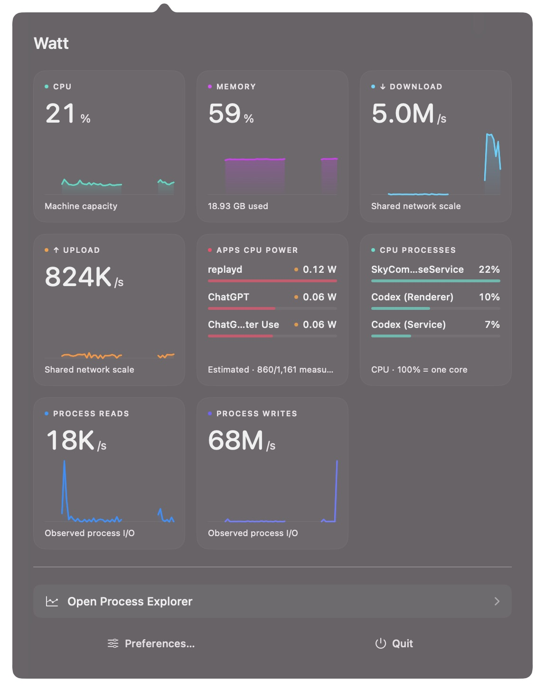
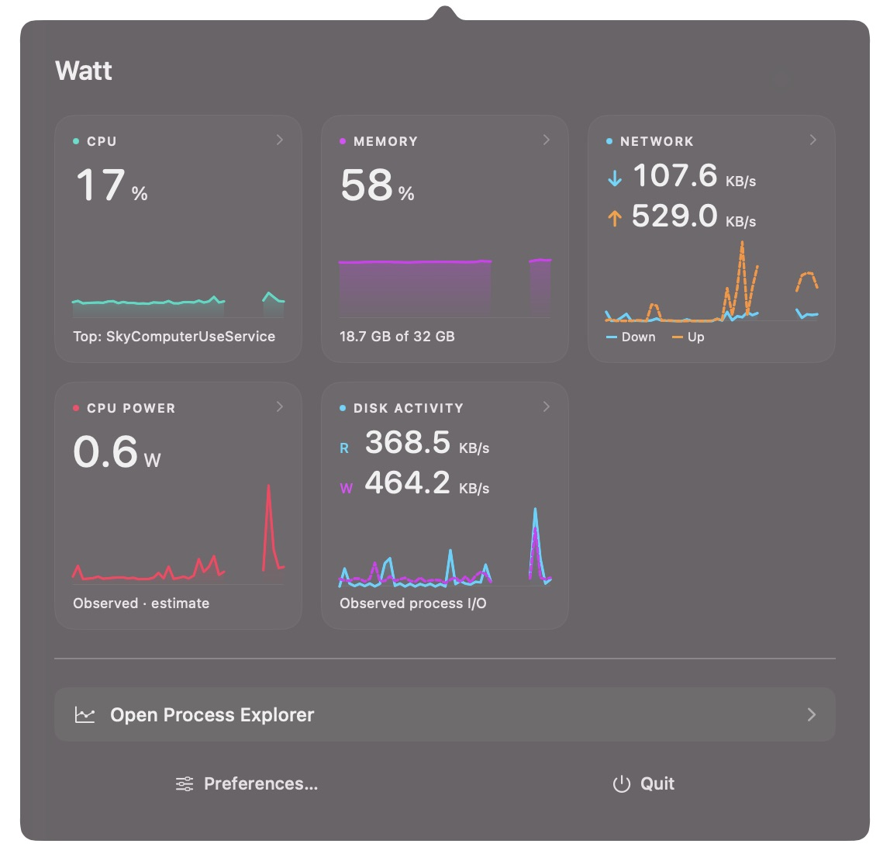
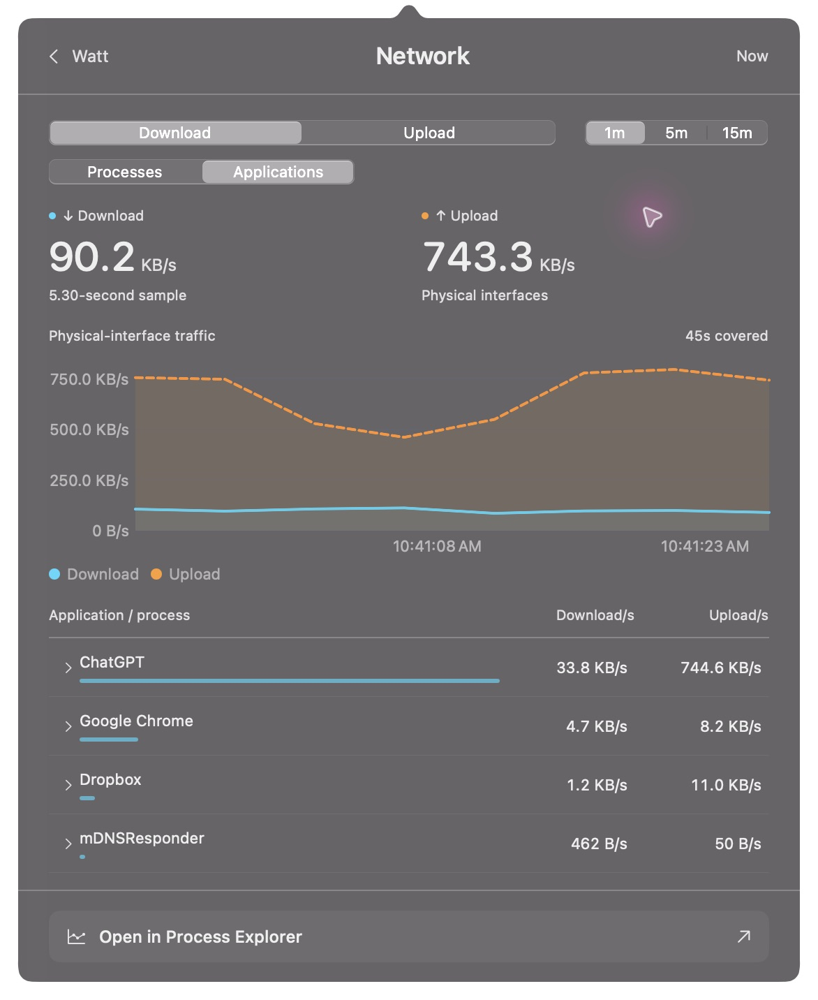
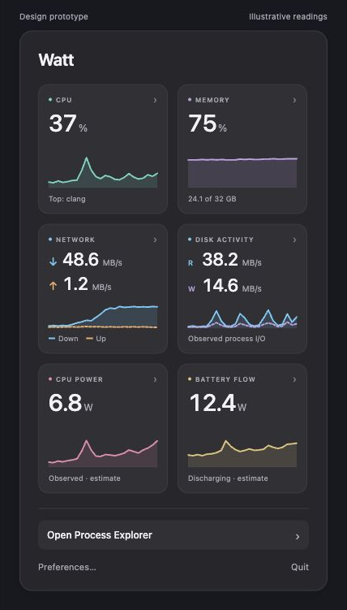
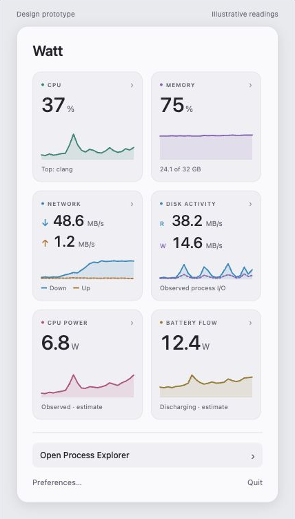

# Tile detail popovers

Approved design and implementation notes, November 10, 2026. The prototype images below use illustrative data. Running-app review captures are separate and use live readings.

## Implemented scope

The implementation provides six default category tiles, the optional dedicated tiles, shared detail navigation, time-pinned graphs, process/application rows, and context-preserving Explorer inspection. Existing custom layouts are consolidated without re-enabling hidden categories or changing the column count; the original layout data is retained for downgrade. Preferences also controls the Energy tile's CPU-power / Energy Impact summary and whether per-process bandwidth is recorded.

Per-process network history uses one passive, bytes-only `nettop` session at the configured cadence. It records external TCP/UDP summaries with exact process lifetimes and capture identities, not endpoint addresses or payloads. Its own interval and capture age are visible because process attribution is delayed relative to the physical-interface headline. Repeated captures, gaps, overlapping intervals, and unavailable measurements are handled explicitly in both views.

Detail history queries are cancellable and bounded to 450 frames, 32 MiB of encoded samples, and 120,000 telemetry records including optional network/energy rows. A busy longer interval may require Explorer's larger query budget. Closing a detail releases its working set and pending read; reopening starts at the overview.

Per-interface addresses/breakdowns, real memory-pressure/accounting additions, extended battery metadata, connection detail, temperatures, and whole-device/component power remain future collection work. Their proposed descriptions below do not imply those fields are implemented.

Running-app dashboard captures retain the existing three-column custom layout and hidden Battery tile, so eight original tiles consolidate into five visible categories. New/reset layouts use the six defaults shown in the design prototype.

Native review verified tile navigation, Escape returning from detail to the overview and then closing it, reopening at the overview, and the Network detail handing its range, grouping, and ranking to Explorer. These captures use local app builds with a separate review identity; the installed app is unchanged. The ad-hoc-signed review copy cannot exercise the Developer ID-only Energy Impact helper. Longer battery and full-recorder overhead measurements remain release validation work.

## Direction

Every dashboard tile should answer one question at a glance, then open a focused investigation when clicked. Keep the square tiles and configurable layout. Put the extra graphs, exact values, and process breakdowns in the detail view.

Use **one menu bar popover with two levels: dashboard and detail**. Clicking a tile replaces the grid with its detail view. A back button restores the dashboard at its previous scroll position. Avoid a second floating window covering the dashboard. Process Explorer remains the place for long investigations, arbitrary dates, process trees, and many columns.

### Consolidated dashboard

The proposed default is six square tiles: CPU, Memory, Network, Process disk activity, Energy, and Battery. Keep the existing 160 pt square size and 12 pt spacing. The merged details do not all need to appear on the summary: Memory shows used memory, while compression and swap live behind its click. Network and Disk each show both directional rates above paired traces. Energy shows one selected measurement, CPU power in these captures; its detail view provides the separate Energy Impact mode. Dedicated direction and ranking tiles can remain optional choices in the layout editor.

These are browser captures of a design prototype with illustrative readings, not screenshots of the running Watt app or evidence of implemented features. They do not substitute for the running-app Before/After screenshots required in an implementation PR.

The 12 existing tiles lead to six detail views:

| Tile clicked | Detail view | Initial selection |
| --- | --- | --- |
| CPU | CPU | System history; processes sorted by CPU |
| CPU processes | CPU | Process ranking emphasized |
| Memory | Memory | Used memory and largest footprints |
| Memory details | Memory | Compression and swap expanded |
| Download | Network | Download emphasized; rows sorted by received rate |
| Upload | Network | Upload emphasized; rows sorted by sent rate |
| Battery flow | Battery | Charge/discharge flow |
| Process CPU power | Energy | CPU watts; individual processes |
| Applications CPU power | Energy | CPU watts; application groups |
| Process Energy Impact | Energy | Energy Impact; individual processes |
| Process disk reads | Process disk activity | Reads emphasized; rows sorted by read rate |
| Process disk writes | Process disk activity | Writes emphasized; rows sorted by write rate |

## Shared layout and behavior

Aim for a detail content width of roughly 520–560 pt and a height around 560–640 pt, limited by the available screen. Keep the menu bar anchor and top edge steady when resizing from the dashboard. A wide dashboard can become a narrower detail view; the saved grid is unchanged. On smaller screens, the central content scrolls while navigation stays reachable.

1. **Header:** back chevron and “Watt,” metric name, and Now or an exact selected timestamp. No Recording label, pause control, or explanatory paragraph.
2. **Readout:** one or two large, left-aligned values with explicit units and a concise scope label. Reserve width for changing digits.
3. **Graph:** a larger, clearly visible trace with readable units and times. Default to the last minute. Offer 5-minute and 15-minute views loaded from recorded history; label the actual covered interval if shorter. Preserve gaps. Receive/send and read/write use paired traces with a common scale and distinct labels/line styles.
4. **Breakdown:** about four to eight visible rows depending on available height, numeric values, and small contribution bars. Full process names are available on selection. Show more in Explorer instead of growing an enormous menu.
5. **Selected-row detail:** selecting a row highlights its trace and reveals its PID, owner, and the relevant exact values. Application disclosure arrows reveal observed child processes. An explicit Inspect process action opens Explorer; simply selecting a row keeps the popup open.
6. **Footer:** Open in Process Explorer. It carries the metric, sort, selected time/range, grouping, and selected process lifetime into the existing window. Do not send the user to an unrelated default view or a separate history screen.

Clicking outside dismisses the whole popover from either level. Escape returns to the dashboard, then closes it. Clicking the menu bar item closes an open popover; reopening starts at the dashboard. Opening Explorer closes the popover. Preferences stays in the dashboard footer; details do not add another settings toolbar.

All graphs and rows describe the same time. Clicking a graph point pins the entire view to that sample and displays its timestamp; Now returns to current samples. This changes the view only, never recording. Arbitrary date selection, range brushing, and comparisons belong in Explorer.

Use the existing restrained surfaces and metric colors, with stronger graph strokes, subtle fills, and precise table alignment. Labels and line styles must convey meaning without color. Make the whole tile a keyboard-accessible button, with a quiet disclosure cue on hover/focus. In the layout editor, tiles continue to support arranging rather than opening details.

## CPU

**Question:** What is using the CPU, and what else was happening?

- Headline: total machine CPU percentage, plus the measured interval. System CPU uses 100% for the whole machine; process CPU uses 100% for one logical CPU. Keep that distinction next to the relevant column.
- Main graph: machine CPU on a fixed 0–100% scale. Selecting a process reveals its CPU trace, clearly labeled with the process scale rather than plotting an uncapped per-core value on the machine scale.
- Default rows: Process, CPU %, Memory, CPU W. A selected row also shows memory growth, read/write rates, wakeups where available, owner, and access/source status.
- Offer Processes and Applications grouping when ownership is supported. Security daemons and unassigned tools stay visible rather than disappearing into an invented app group.
- Explorer handoff: CPU sort, matching time, and selected process. The full process tree lives there.

Later additions worth considering: user/system/idle breakdown, core-group history, load average, and thermal state. These need additional captured fields; they are not part of the currently recorded CPU total.

## Memory

**Question:** How much memory is in use, and which processes are large or growing?

- Headline: used / physical memory in bytes, with the used percentage as a secondary value.
- Main graph: used memory. Compact aligned tracks show compression and swap; the Memory details tile opens with those tracks expanded.
- Default rows: Process, Footprint, Change in range. Let the user sort by footprint or growth. Selecting a row shows its footprint history with the system tracks still aligned.
- Detail values: current, range peak, and observed change. Do not present a sum of process footprints as the system used-memory total.
- Memory pressure, app/wired/cache accounting, and paging would be useful additions, but their separate sources and persistence must be added first. Until then, do not label used-memory percentage or compression as pressure.
- Explorer handoff: footprint or growth sort, matching time, and selected process.

There is no invented per-process “memory impact” score. Footprint, growth, compression, swap, and a real system pressure signal provide the evidence.

## Network

**Question:** Who is using the connection, in which direction, and how much have they transferred?

Download and Upload open the same view, with the clicked direction selected. Both directions remain visible.

- Headline: Download and Upload, with full units such as MB/s rather than ambiguous K/M abbreviations.
- Main graph: paired receive/send histories, zero baseline, labeled scale, and a clearly visible time cursor. Selecting a row shows its traffic against a subdued aggregate reference; labels distinguish selected traffic from the interface total.
- Default rows: Application / process, Download/s, Upload/s. A small bar reinforces the clicked direction. Application groups disclose individual processes; a dedicated system/security agent remains identifiable by process name and owner.
- Selected-row detail: PID/start identity, received and sent bytes **in the displayed interval**, average/peak rates, and measurement coverage. Label totals as observed; do not imply “since launch” when capture began later.
- An Interfaces disclosure shows the available physical-interface breakdown and addresses where supported. Interface scope is shared by both the graph and the table. It must not combine physical and tunnel counters into a double-counted total.
- Keep endpoint addresses, connection lists, transport details, and DNS lookups out of the first view. They are a later, on-demand investigation, not required for useful per-process bandwidth.
- Explorer handoff: received/sent sort, the same scope/time, selected process, and process-network history columns.

### Network collection is new work

Today Watt records aggregate interface rates only. It does not record per-process network counters or retain per-interface identity. The process table and interface breakdown are proposed capabilities, not a UI over existing data.

The intended collection has two levels:

- Lightweight process receive/send summaries recorded at the existing sampling cadence, so a later investigation can answer who was transferring data. It must preserve process lifetimes and final observed counters when a process exits.
- Optional connection-level detail collected only while explicitly requested. Do not record hostnames, remote endpoints, or payloads by default.

Validate a passive adapter on supported macOS versions before committing to its access requirements or enabling it by default. An approved helper is an accepted option. Apple's network-statistics structures expose useful counters and identities, but that interface is private and access varies; it is not a promise of stable public API support. Use the installed `nettop` tool as a comparison reference during validation. Never launch a new `nettop` command every refresh or introduce a traffic-intercepting extension just to display rates.

Per-process and physical-interface totals can differ because their scopes and attribution differ. Do not force them to reconcile or manufacture an “Other” row from an unexplained subtraction. Show unavailable attribution and source coverage separately. Avoid an invented percentage of “traffic accounted for” unless the compared counters have a validated common scope.

If collection is disabled, unsupported, or was not active at a past time, retain the aggregate graph and show **Process traffic not recorded**, with an appropriate setup action. Permission-limited processes remain listed as restricted rather than showing 0 B/s. If the collector cannot meet Watt's overhead budget, expose that tradeoff in Preferences rather than silently recording only while the popup is open.

## Process disk activity

**Question:** Which processes are reading or writing, and how much?

- Headline: observed process read and write rates, both visible. The clicked direction controls initial emphasis and ranking.
- Main graph: paired read/write rates. Scope is explicitly Process I/O, not disk-device throughput.
- Default rows: Process, Read/s, Write/s. Selected-row detail adds read/written bytes in range, average/peak rates, CPU %, and footprint.
- Include helper/system/security processes when available; preserve restricted readings and coverage.
- Explorer handoff: read or write sort, matching interval, and selected process.

Device utilization, IOPS, latency, volume attribution, and file paths are separate future measurements. File paths are not needed to make this first breakdown useful.

## Energy

**Question:** Which processes or application groups have measurable CPU power or Energy Impact?

Use a single detail view with a clearly labeled **CPU power / Energy Impact** selector. Keep units and definitions distinct.

**CPU power:**

- Headline: measured process CPU watts, marked as an estimate and an observed subtotal. It is not whole-device power.
- Graph: observed CPU-power history; show joules and weighted average/peak watts for the interval.
- Default rows: Process or Application, CPU W, CPU %, Memory. Selected rows add CPU joules, wakeups/s where available, and coverage.
- The Applications CPU power tile starts in application grouping. Disclosure reveals the included observed helpers and which readings are unavailable. Do not claim exact Activity Monitor grouping.

**Energy Impact:**

- Headline: the leading process and its unitless Apple-derived score, rather than a misleading watt total or aggregate app score.
- Graph: the selected process's score history, with actual capture times and gaps.
- Default rows: Process, Impact, CPU %, Wakeups/s. Show sample age and coverage when needed. Do not interpolate stale scores as current.
- Exact application aggregation is not currently validated, so this mode starts with individual processes. A process tree or owner information remains available in Explorer.

Both modes hand the metric, grouping, time, and process selection to Explorer. Battery watts and CPU watts do not share an interchangeable axis, and Energy Impact is never relabeled as watts.

## Battery

**Question:** Is the battery charging or discharging, and how has its electrical flow changed?

- Headline: Charging / Discharging / On external power, followed by measured battery-flow watts where valid. A genuine unavailable reading is a dash, not zero.
- Main graph: signed battery flow with a visible zero line and distinct charge/discharge labels. Preserve power-source changes and recording gaps.
- Detail values: measured voltage/current, source, reading time, and observed interval coverage.
- Additional charge percentage, remaining-time estimate, capacity/health, and cycle count are useful, but require extending collection and history. Their availability must be checked individually.
- A compact CPU-power contributor list can provide context, with an explicit label. It must not allocate battery discharge to processes or imply that it includes display, GPU, radios, and the rest of the system.
- Explorer handoff: battery-flow track at the matching time; include CPU-power context without inventing attribution.

On AC, do not rename battery flow to system consumption. CPU/GPU/SoC watts and temperature sensors should get their own future tile/detail content when a validated source exists.

## Data, performance, and unavailable states

- Reuse the recorder's existing samples, process inventory, app grouping, and cadence. Opening a detail view must not start another general process scan, helper timer, or recorder.
- Lazily read bounded longer-range history once when requested, then reuse the results. Do not query SQLite for every mouse movement or rebuild every process history during every draw.
- Only the visible detail subscribes to expensive presentation work. Closing it cancels pending view queries and releases derived rows. Recording continues at the configured cadence.
- Sort and calculate summaries away from drawing; retain focus and selection by PID/start lifetime, never row index. Show a bounded ranking and send full tables to Explorer.
- Use actual sample intervals for rates. The first baseline, a reset, a gap, and an inaccessible counter are distinct from measured zero.
- Distinguish **Not recorded**, **Restricted**, **Unsupported**, **Waiting for first interval**, and **Stale**. Explain a state in a short status row or selected-process detail rather than permanent paragraphs.
- No foundation model is needed for these views. Ranking, totals, and synchronized traces should come directly from measurements.
- Keep the existing CI performance gate unchanged. Before accepting the new collector, measure idle/closed-popup, detail-open, and heavy-load recording on a real Mac, including helper cost and battery behavior where measurable. A passing fixture UI test alone does not establish low recording overhead.

## Proposed order after design agreement

1. Shared navigation, larger graphs, and contextual Explorer handoff. CPU, memory, process disk activity, CPU power, Energy Impact, and existing battery fields can use recorded data.
2. Per-process network feasibility and overhead validation; then recording, detail table, and matching Explorer history together. Do not ship live-only attribution as if it answers past incidents.
3. Additional memory pressure/accounting, battery metadata, interface context, and validated sensor/component-power tiles.

The first review should settle the in-place navigation, information density, and default columns. Keep the collector implementation as a separate decision once its measurements and cost are known.

## Evidence and reference points

- Current tile catalog: `Sources/Watt/PopupLayoutSettings.swift`.
- Existing tile values and definitions: `Sources/Watt/PopupDashboard.swift`.
- Recorded fields and bounded live history: `Sources/Watt/Model.swift`.
- Battery source fields: `Sources/Watt/PowerReading.swift`.
- Aggregate network source: `Sources/CTelemetry/Telemetry.c`.
- Existing history and Explorer controls: `Sources/Watt/HistoryStore.swift`, `Sources/Watt/ProcessExplorerView.swift`.
- [Apple XNU network statistics definitions](https://github.com/apple-oss-distributions/xnu/blob/main/bsd/net/ntstat.h) and [implementation/access checks](https://github.com/apple-oss-distributions/xnu/blob/main/bsd/net/ntstat.c). These establish feasibility questions, not a stable API contract.
